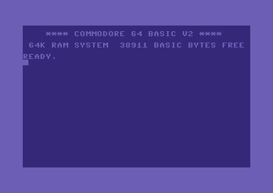

# C64Basic

A Commodore 64 in C# (.NET 10): the real C64 ROMs on a cycle-stepped 6502, VIC-II, SID and CIA models, and a real 1541 (its own 6502 running the DOS ROM)
reading D64 and G64 disk images, so games with fast loaders and 1541 copy protection run. It opens in a window with sound, keyboard,
joystick, cartridges and a RAM expansion unit. (Earlier versions were a BASIC V2 interpreter that needed no ROMs; that mode is gone, see the changelog.)

The ROM dumps are copyrighted and not included: see [what is needed](#the-machine-the-real-roms-and-a-real-1541).

```
dotnet run --project src/C64Basic.Gui -- --disk game.d64 --start      # boot, load the first program of the disk and run it
dotnet run --project src/C64Basic.Gui -- --help
dotnet test
```



## Layout

| Path | Contents |
|---|---|
| `src/C64Basic.Core` | the machine: `Machine` (memory bus, 6502 CPU, VIC-II, SID, CIA, VIA, cartridges, REU, datasette, lockstep scheduler), `Rom` (the 1541, serial bus, disk mechanics, GCR images, the whole machine), `Disk` (D64, G64, T64, TAP, PRG file formats), `IO` (keyboard matrix, joystick, text selection), `Runtime` (PETSCII and the built-in character set) |
| `src/C64Basic.Gui` | windowed front end on SDL2 (Silk.NET): VIC-II frames, SID audio, keyboard, joystick and mouse |
| `tests/C64Basic.Tests` | xUnit tests; those that need the ROM dumps or a game image skip without them |

## The machine: the real ROMs and a real 1541

This is not a BASIC interpreter or an emulated KERNAL: it runs the actual thing. The C64's own BASIC and KERNAL ROMs run on the 6502
(banked by the processor port, with the real interrupt handler, keyboard scan and serial bus routines), and beside it a 1541, a second
6502 running the DOS ROM with 2 KB of RAM and two 6522 VIAs, reads a disk image through a model of the head, the stepper, the motor and the
GCR read channel. That is what **fast loaders** (they upload their own code to the drive and race the serial bus), 1541 copy protection
and anything that calls the real KERNAL or BASIC routines need.

```
dotnet run --project src/C64Basic.Gui -- --disk game.g64 --start
```

The ROM dumps are copyrighted and **not part of this project**, and the program cannot start without them. Put them in a folder named `roms` (git-ignored here) in the working directory or next to the program, or point to another folder with `--rom-dir <folder>`; a missing ROM is reported with the file names needed. They are found by
name or by size: the 8 KB BASIC ROM (`basic-901226-01.bin`), the 8 KB KERNAL (`kernal-901227-03.bin`, stock PAL), the 16 KB 1541 DOS ROM
(`dos1541ii-251968-03.bin`, the 1541-II's DOS 2.6) and optionally the 4 KB character ROM (`chargen*.bin`, otherwise the built-in
approximation is used). The checksum is only used to say which ROM it is. Tests that need the ROMs do nothing without them.

What you get: the real boot (a RAM test, then the banner after about three seconds), BASIC V2 as Commodore wrote it, `LOAD`, `SAVE`,
`OPEN` and the command channel through the real serial routines against the real DOS, D64 and G64 images (a G64 is the raw bit stream
of every track, half-tracks and speed zones included), disk swaps, `RESTORE` and RUN/STOP+RESTORE, the joystick, paddles and light pen,
and a keyboard that goes through the matrix (so Ctrl, the Commodore key and Shift behave like the real ones).

There are up to two drives: `--disk 8=a.d64 --disk 9=b.d64` puts a second 1541 (its own 6502 running the DOS, in the same lockstep) on the
serial bus as device 9, so `LOAD"X",8` and `SAVE"X",9` copy between disks; the window title shows which drive is turning. A state file
keeps the number of drives it was taken with.

**Expansion port:** `--cart <file.crt>` plugs in a cartridge image and `--reu <kb>` a RAM expansion unit; both reset the machine (dropping
a `.crt` on the window does too). The memory map follows the GAME and EXROM lines: an 8 KB cartridge shows at $8000 while LORAM and HIRAM are set,
a 16 KB one also at $A000 in place of BASIC (HIRAM), and Ultimax mode (GAME low, EXROM high) gives the cartridge $8000 and $E000 (its own reset
vector) with RAM only at $0000-$0FFF. The KERNAL starts a cartridge with the `CBM80` signature itself. CRT hardware types supported: 0 (normal),
5 (Ocean), 15 (C64 Game System), 19 (Magic Desk) and 32 (EasyFlash, read only: the flash cannot be written, so a program that saves to it will
not keep anything); freezer and other cartridges are refused. The REU (128 KB to 16 MB, registers at $DF00-$DF0A) does C64-to-REU, REU-to-C64,
swap and verify transfers with the fixed-address and autoload options, the FF00 trigger and the end-of-block and verify-error interrupts;
a transfer takes a cycle a byte with the processor held. A cartridge and an REU share $DF00, so the cartridge wins. Saved states keep the
bank registers and the REU's contents but not the cartridge's ROM: start with the same `--cart` and `--reu` to load one.

In the window: Ctrl+N and Ctrl+B swap the disk in drive 8 for the next or previous `.d64`/`.g64` in the same folder, in name order (the
disks of a multi-disk game side by side), Scroll Lock pauses the machine and shows the registers of the processors, the raster line and the drive's
head in the title, and dropping a `.tap` mounts a tape (a `.t64` or `.prg` goes on a blank disk).

`--disk` also takes a `.t64` tape image or a single `.prg`: its programs go on a blank disk in memory (nothing is saved back), then
`LOAD"NAME",8,1` and `RUN` as usual.

`--tape <f>` is a datasette on the cassette port with PLAY pressed: a `.tap` is fed to CIA 1's FLAG pin pulse by pulse
while the KERNAL's motor line (bit 5 of the processor port) is low, so the real tape routines (and turbo loaders) read it, the sense switch
(bit 4) reads closed, and `LOAD` / `SAVE` without a device number use the tape, with the KERNAL's own timing (a program takes a minute or two
of emulated time). A `SAVE` records the rising edges of the write line (bit 3) as pulses and adds them to the tape when the motor stops; a
missing `.tap` is created empty and written. A `.t64` is put on a tape in the KERNAL's format, in memory. A saved state keeps the tape position
(the tape file itself is mounted again by the host). In the window Ctrl+T lets go of PLAY and presses it again, Ctrl+R rewinds (`RomMachine.StopTape`, `PlayTape`, `Tape.Rewind`).

The drive **writes**, too: the write head puts what the DOS sends on the track, so `SAVE`, `SCRATCH`, `VALIDATE`, block commands and a
full `NEW` (format) work against the real DOS. A mounted `.d64` file is saved back after every write (once all its sectors read cleanly
again, so never half-way through a format; a missing `.d64` is created blank). A `.g64` is someone else's raw tracks: the drive may write
to the copy in memory, the file is never touched, and the title says so. The undocumented opcodes copy protection likes are there too,
the unstable ones (XAA, LAX #, AHX, TAS, SHX, SHY, LAS) with the values most emulators agree on.

Ctrl+S and Ctrl+L save and load the whole machine (`--state <file>`, `--resume`): both processors, RAM, every chip, the drive's head
and the disk as it is now. It is exact: a state taken in the middle of a fast load carries on to the same bytes as the original run.
The window title shows the drive at work (`1541: track 18`, `writing`); `--iec-rise <us>` changes the serial bus rise time (below).

The VIC-II holds the C64's processor up cycle by cycle (BA/AEC): BA goes low three cycles before the chip needs the bus (cycle 12 of a bad
line, cycle 55 for the first sprite), the 6502 stops in its first read cycle after that, writes carry on for up to three cycles (a `STA` or
an interrupt's pushes slip through), and it runs on when BA is high again (cycle 55 on a bad line). So a bad line costs a processor that
reads 43 cycles (40 if it was pushing), a sprite 2 and the first of a row of sprites 3 more (8 sprites: 19). Stretches that are less than
three cycles apart are one. The cost is worked out before the instruction runs, so a read of `$D012` or a CIA register after a stall sees
the time after it, and the scheduler orders the processors by it. A page crossing or a taken branch (the cycle it adds) is not held up.

How the two processors stay in step: the C64 (985248 Hz) and the drive (1 MHz) run in lockstep. The one whose next bus access, the data
access in the last cycle of its next instruction, comes first takes the next step, so a store by one and a load by the other happen in
the right order within a cycle. That is what a fast loader needs: the 1943 loader here sends two bits at a time with a window of a couple
of microseconds, and only works when a released serial line rises about a microsecond late (a line is only pulled up by a resistor through
the cable's capacitance), which the model has: 1.2 microseconds, and anything from about 0.8 to 1.7 loads the game, none at all does
not. If a fast loader that works on a real machine fails here, `--iec-rise` is the knob to try. A boot from a game image takes about a
minute of emulated time, the same as the real machine, and `--fast` skips the speed limit. Measured in a Release build (BASIC idle, and a fast
loader at work), the machine runs about 17 to 19 times faster than the real machine, so a boot with `--fast` takes a few seconds.

Games are tested against real images kept in `roms/games` (git-ignored, copyrighted, so the tests skip on a machine without them): `GameCorpusTests`
loads every `.d64`, `.g64`, `.t64` and `.prg` there and lists its directory, and runs the ones it knows by name to their title screen. Known to work:
1943 (a G64 with a drive-code fast loader), International Karate Plus (a D64, a 200-block KERNAL load, then the cracker's raster-bar intro and menu)
and Ms. Pac-Man (a T64, put on a blank disk). To add a game, drop the image there and add a row to that file.

Known limits: a gate-for-gate chip simulation this is not. The VIC-II draws a frame from a log of register writes (raster tricks
and bad lines, but not every cycle-level effect), freezer cartridges and cartridge flash are not there, and the jams ($02, $12, ...) stop the machine with a message in the title bar.
The disk head counts its cells at the speed the density bits (PB5-PB6 of VIA 2) select, as the real one does, and the disk turns at 300 rpm
whatever they say: with the density a track was recorded at every bit is read as recorded, with another one the stream is sampled at the wrong
rate (a bit is missed or seen twice), so code that sets the density wrong, or a protection that records at an odd speed, sees what it would on
a real drive. What the head writes is recorded at the density it is set to, so a track can end up with bytes of different speeds; a G64
keeps those (and any per-byte speed table it came with) when it is written back. A mounted G64 is only written back with `--write-g64`
(then the file is rewritten from the tracks, and the first time the original is copied to `name.g64.bak`); a D64 is always saved back. The stepper
moves a half-track per phase change; a jump of two phases (the opposite coil) carries on the way the head was going, a model of an unstable
position, not a measured one. A written track keeps its length (bits are overwritten in place, a different density does not change how many fit).

## VIC-II, SID and CIA

`Bus` models the VIC-II and SID registers. `Bus.Vic.Render(uint[])` draws a 384x272 ARGB frame: text,
multicolour and extended-colour text, hires and multicolour bitmaps, custom character sets, the VIC bank from
`$DD00`, and eight sprites (expansion, multicolour, priority, sprite-sprite and sprite-background collisions).
`$D012`/`$D011` give a raster line that advances at 50 Hz (312 lines of 63 cycles) and the raster-compare flag is set in `$D019`.
The picture is drawn per raster line from a log of register writes, so changes made mid-frame by raster interrupts show up where
they were made: colour bars, split screens, sprite multiplexing (a sprite register rewritten after its line is drawn gives a second
sprite), fine scrolling (`$D011`/`$D016`), and the border tricks that open the top/bottom border (RSEL switched at the right line) and
the side borders (CSEL switched at cycle 56/57). The VIC-II holds the processor up on bad lines and for sprites (see below), so a stable raster interrupt sees the same line every frame. Sprite pointers (the last bytes of screen memory) are logged with the raster line and cycle they were written at, like the registers, so a game that multiplexes sprites by rewriting Y and the pointers down the frame shows each copy with its own image.
`Bus.Sound.Render(short[], sampleRate)` produces mono audio: three voices, four waveforms, ring modulation,
sync, ADSR, a state-variable filter and volume. `Bus.Sound.Model` picks the 6581 (default; dark, strongly non-linear filter,
combined waveforms lose bits) or the 8580 (`--sid 8580` in the GUI; linear cutoff, cleaner combinations). Noise combined with another
waveform locks up as on the real chip. In the window the SID is played from the machine's own time: register writes are stamped with the emulated time and replayed 60 ms behind it, so a gate or frequency changed twice within one audio buffer is heard twice. The combined waveforms are modelled, not sampled from real chips. `Vic.LightPen(x, y)` is a light pen strike: the first in a frame latches `$D013`/`$D014` and sets the interrupt flag (bit 3). A SID frequency register tops out near 3.8 kHz, as on a real chip.

`Bus.Cia1`/`Cia2` are 6526 chips with two ports, two timers (also chained), time of day with the hours latch, and an
interrupt register; they run from `Bus.Seconds`. CIA 1 reads a host-supplied `IInputDevice` (`InputState`) through the real keyboard
matrix and joystick ports, CIA 2 port A picks the VIC bank, and CIA 1 timer A is
the 60 Hz system interrupt. Timers A/B drive PB6/PB7 (pulse or toggle), the shift register
clocks a byte out on timer A (`SerialOut`) or takes one from the host (`ReceiveSerial`) and raises its interrupt, and the TOD alarm sets
flag 4. `Cia.PulseCnt(n)` feeds pulses to the CNT pin: timer A counts them (CRA bit 5), timer B counts them or A's underflows, optionally
only while `CntHigh` (CRB bits 6-5). Nothing in the front ends drives CNT; it is for hosts and tests. `PulseFlag()` is a falling edge on FLAG (ICR bit 4). `Bus.Cia2.UserPortInput`/`UserPortOutput` are the user port pins (PB0-7). Saved machine states (`.sav`, include the timer outputs, shift register and CNT level.

**Paddles:** `IInputDevice.Paddle(port, axis)` is what the SID reads at `$D419`/`$D41A`; CIA 1 port A bits 7-6 pick the game port (writing `$40` to `$DC00` =
port 1, `$80` = port 2, as the C64 documents it; selecting both or neither reads 0). The fire buttons are the joystick's left and right bits
(`$DC00` bits 2 and 3). In the GUI the mouse is a paddle on the port the numpad drives: its position is POTX/POTY (0-255 across the
window), the left button is fire A and the right button fire B. With `--lightpen` the mouse is a light pen on port 1 instead: holding
the left button over the picture strikes the pen at that beam position (`Vic.LightPen`: `$D013`/`$D014` and interrupt flag 3) and holds the
joystick fire line (`$DC01` bit 4) low.

## The GUI

`src/C64Basic.Gui` opens a window and runs the machine on its own thread; the window shows what `Bus.Vic.Render` draws from it and plays
the SID through SDL.

```
dotnet run --project src/C64Basic.Gui -- --disk game.d64 --start --joy-keys 2
```

- Options: see `--help`. The common ones are `--disk [n=]<file>`, `--start`, `--tape`, `--cart`, `--reu`, `--joy-keys <1|2>`, `--scale <1-8>`, `--fast` (start in warp mode), `--fullscreen`, `--type <text>` and `--snapshot <file.bmp>` (for scripting and screenshots).
- Keys: Esc = RUN/STOP, F1-F8, Home (Shift+Home clears), Ctrl+1-8 / Alt+1-8 pick the text colour, Ctrl+9/0 reverse on/off.
  They go through the key matrix the real KERNAL scans; the numpad is a joystick (8/2/4/6, 0 = fire) on port 2, or on port 1 with `--joy 1` or the Pause key. Game controllers work too: the
  first is on port 2, the second on port 1, with the D-pad or left stick for directions and A/B/X/Y for fire, and they can be plugged in
  while the window is open.
  F9 toggles warp speed, F10 resets, F11 or Alt+Enter toggles full screen, F12 saves a screenshot. Dropping a `.d64`, `.g64`, `.t64`, `.tap`,
  `.prg`, `.crt` or `.sav` file on the window mounts or loads it.
- START (Ctrl+Enter): resets and runs `LOAD"*",8,1` + `RUN` on the disk in drive 8; `--start` does the same at launch
  (`--rom-dir roms --disk game.d64 --start`). Opening a disk with OPEN or by drop already does this.
- Keyboard joystick: the JOY button (Ctrl+J) cycles the cursor keys between being cursor keys, a joystick on port 1 and a joystick on port 2,
  with Space or Right Ctrl as fire (Space still types a space); the numpad follows to the same port. Games differ in the port they read:
  Ms. Pac-Man reads port 1, many read port 2. Pause moves the numpad joystick between the ports without touching the cursor keys.
- Volume: the SID at full volume is close to full scale, far louder than other programs, so the window plays it at 40 % to begin with.
  `--joy-keys <1|2>` starts with the cursor keys as the joystick on that port (Space = fire; Ctrl+J or the JOY button cycle off, 1, 2), `--volume <0-100>` sets the start level, Ctrl+Up / Ctrl+Down change it in steps of 10 %, Ctrl+M (or the speaker icon) mutes, and the
  speaker buttons at the end of the toolbar do the same. The emulated chip's own output is not changed, only what reaches the sound card.
- Toolbar and mouse: a toolbar of small pixel icons runs along the top of the window (open folder, joystick, reset, fast-forward for warp, save, load, copy, paste,
  camera, full screen, pause, previous and next disk, cassette and rewind), each with a tooltip (what it does and its key) that
  appears under it when the pointer rests on it, lit while a toggle is on (the joystick icon carries the port: - / 1 / 2). It
  hides in full screen, `--no-toolbar` leaves it out and Ctrl+F12 switches it on and off. Shift + left drag picks text off the screen (the
  picked cells are drawn inverted) and copies it when the button is let go; COPY and Ctrl+C copy the selection, or the whole screen if
  nothing is picked; a middle click, PASTE, Ctrl+V and Shift+Insert type the clipboard. Without Shift the mouse is still the paddle (or the
  light pen), and any key or an ordinary click drops the selection.
  OPEN (Ctrl+O) shows the system's file dialog (the common dialog on Windows, `zenity` or `kdialog` on Linux, AppleScript on macOS) to pick a
  disk, tape, cartridge, program or state file, the same as dropping it on the window. A picked disk (`.d64`, `.g64`, `.t64`,
  `.prg`) or `.tap` resets the machine and starts its first program (`LOAD"*",8,1` and `RUN`, or `LOAD` and `RUN` for a tape); a `.crt` resets
  into the cartridge and a `.sav` loads the state.
- Machine state: Ctrl+S saves the whole machine (both processors, RAM, every chip, the drive's head and the disk as it is now) to `c64-state.sav` (`--state <file>` changes the name) and Ctrl+L loads it; `--resume` loads it at startup and dropping a `.sav` file on the window loads that. It is exact: a state taken in the middle of a fast load carries on to the same bytes. A damaged file is refused without changing anything.
- Clipboard: Ctrl+V or Shift+Insert types the clipboard through the keyboard buffer (line breaks become RETURN; characters the C64 keyboard cannot produce are dropped; at most 64 KB), so a BASIC listing can be pasted in. Ctrl+C copies the screen as text.
- Character sets: the real ROM is copyrighted, so the built-in set is drawn in this project (C64-style letters and digits,
  hand-drawn graphics for screen codes 64-127, a lower-case set, reversed halves). Shift+Alt (Shift+Commodore) or
  a program's `CHR$(14)` / `CHR$(142)` switches between the upper-case/graphics and lower-case sets (`$D018` bit 1). To use the
  real glyphs, pass a 4096-byte dump with `--chargen <file>`. `Bus.LoadCharacterRom` does the same in code.
- Limits: the graphics are approximations of the real shapes. The mouse is the only paddle (one at a time, on the numpad's port); game
  controller triggers do not drive paddles.

## Performance

Drawing a frame takes about 1.5 ms whatever the program did to the VIC-II registers: the register log is replayed per line, and it is folded
into the starting state past 20,000 entries, so a program that writes a register every cycle for seconds costs nothing extra (2 million
logged writes take about 0.4 s, 0.2 microseconds each). Measured with a Release build on a desktop PC.

## Tests and releases

`dotnet test` runs the xUnit suite; tests that need the ROM dumps or a game image show as skipped without them. Klaus Dormann's 6502
functional test runs too if `roms/cputests/6502_functional_test.bin` exists (not included: it is GPL; CI fetches it).
`.github/workflows/ci.yml` builds and tests on Linux and Windows (the ROMs are copyrighted, so CI cannot run the ROM-dependent tests),
and a `v*` tag publishes self-contained GUI builds for win-x64, linux-x64 and osx-arm64 as release assets. What needs a real screen,
keyboard and speakers is listed in [docs/GUI-CHECKLIST.md](docs/GUI-CHECKLIST.md).

## License

MIT, see [LICENSE](LICENSE). The C64 and 1541 ROMs are not included.
